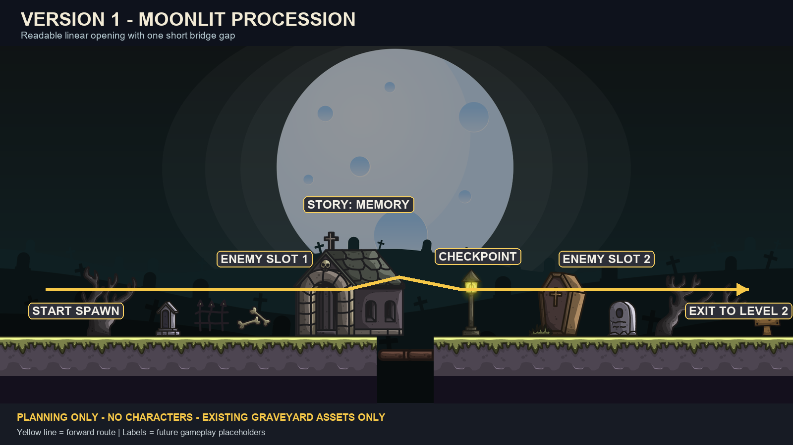
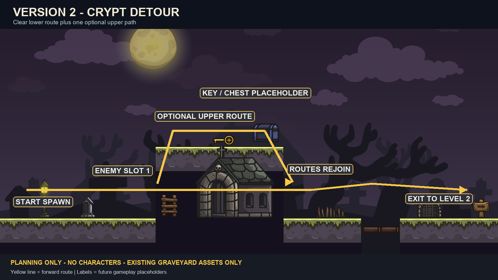
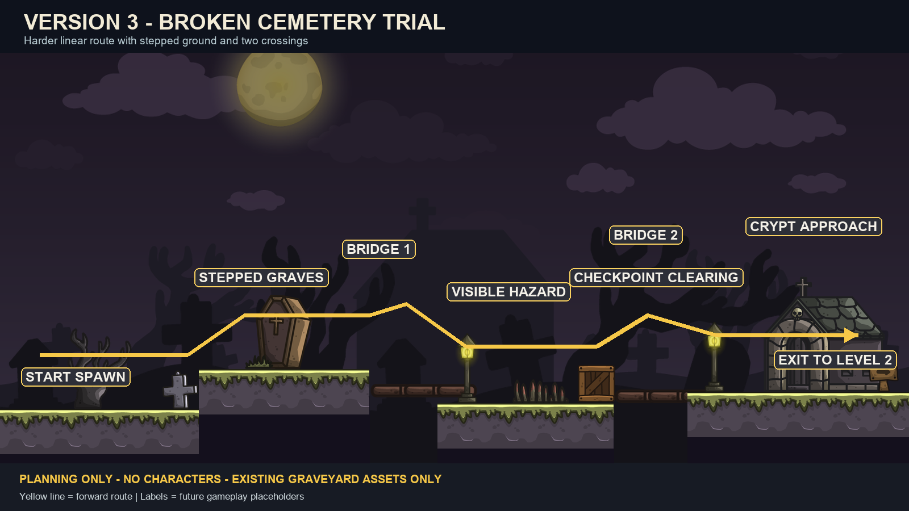

# Silent City - Outer Graveyard Side-Scroller

## Three level-design versions using the available graveyard assets

This document is for **level-design planning only**. It does not authorize changes to game scenes, scripts, tilesets, collisions, characters, online mode, or multiplayer systems.

The character files are not currently available. Each layout therefore uses labeled placeholders for the player spawn, enemy slots, story triggers, checkpoint, and exit. Character and enemy assets can be connected later without changing the basic route.

## Official campaign direction

1. **Outer Graveyard:** graveyard opening level with skeleton enemies.
2. **Forgotten Path:** a deeper, darker, harder underground or ruined passage with more dangerous skeleton encounters. The Minotaur can serve as the guardian/mini-boss near its end or at the Sanctum approach.
3. **Wizard's Sanctum:** the darkest and hardest final level, with skeleton guards, traps, magical hazards, and the Wizard as the final boss.

The official third-level name is **Wizard's Sanctum**, not Wizard's Castle. The Minotaur is a guardian/mini-boss; the Wizard is the final boss.

## Asset boundary

Use only assets already present in these folders:

- `../GraveyardTileset`
- `../GraveyardTileset_second`

These are portable paths relative to this `Level_Design_Documents` folder. Keep the complete `Graveyeard_Tilesets_Objects` folder together when moving it to another computer; no Windows user name or drive letter is required.

For all future prompts and level documents, reference every related PDF, image, tileset, asset folder, or supporting file with a **relative path from the current document or agreed project root**. Never use a fixed drive letter, Windows username, home folder, or other computer-specific absolute path.

Available assets include graveyard backgrounds, ground and ledge tiles, bridge parts, brick and stone pieces, ladders, spikes, crypts, coffins, fences, lanterns, trees, tombstones, rocks, bones, skulls, bushes, signs, crates, barrels, keys, chests, life, mana, stars, and coin frames.

Do not download, generate, trace, or import replacement artwork. Do not use the earlier concept drawing as an art source. It communicates only the general side-scrolling direction.

---

## Version 1 - Moonlit Procession



### Design goal

A clean, readable opening level with a mostly continuous floor. It teaches left-to-right movement and basic traversal while delivering the awakening story with a dark but readable atmosphere.

### Route

1. **Awakening ground:** player placeholder spawns beside tombstones, bones, and a dead bush.
2. **Teaching stretch:** long safe floor with fences, signs, rocks, and small decorative changes.
3. **First pressure zone:** two future skeleton-enemy slots separated by safe recovery space.
4. **Crypt landmark:** the crypt acts as the visual midpoint and holds the first memory/story trigger.
5. **Bridge gap:** one short, clearly readable bridge crossing introduces danger without demanding precise platforming.
6. **Final grave row:** denser tombstones, coffin, lantern, and one harder future skeleton-enemy slot.
7. **Exit:** signpost and lantern mark the transition toward the Forgotten Path.

### Difficulty

Lowest of the three versions. The route is direct, forgiving, and suitable for testing every future playable Golem.

### Copy-paste prompt

```text
Create a detailed level-design plan for Silent City story mode, Level 1: Outer Graveyard, using Version 1 - Moonlit Procession.

This is planning only. Do not edit or create game scenes, scripts, tilesets, collisions, characters, online mode, multiplayer code, or shared resources.

Use only PNG assets already present in these paths relative to this document:
- ../GraveyardTileset
- ../GraveyardTileset_second

Do not download, generate, trace, or import any new artwork. Do not use the concept drawing as an art source. It is only a reference for left-to-right side-scrolling structure.

Design a dark, readable graveyard level that moves mainly from left to right with continuous ground near the bottom. Follow this sequence: awakening ground, teaching stretch, first pressure zone, crypt story landmark, one short bridge gap, final grave row, and exit toward the Forgotten Path.

Use existing backgrounds, ground tiles, bridge parts, crypt, coffin, fences, lanterns, trees, tombstones, bones, rocks, bushes, signs, crates, and barrels. Keep decorative objects non-collidable in the future implementation. Reserve labeled placeholders for player spawn, future skeleton-enemy slots, checkpoint, story trigger, and exit. Do not add character or enemy artwork yet.

The atmosphere should be darker than the old design but gameplay surfaces must remain visible. Use lanterns and the existing moonlit backgrounds to guide the route. Keep jumps fair, avoid blind landings, avoid maze-like construction, and leave enough clear space for unknown character sizes and abilities.

Return a section-by-section layout specification, approximate screen lengths, collision intentions, object-placement list, placeholder locations, camera-flow notes, and a checklist for later implementation. Wait for approval before any game changes.
```

---

## Version 2 - Crypt Detour



### Design goal

A more exploratory side-scroller with one optional upper route. The critical path remains obvious, while a ladder and raised platforms create a short detour around the central crypt.

### Route

1. **Awakening slope:** player placeholder starts on stable ground beside a sign and lantern.
2. **Lower cemetery road:** direct route with tombstones, fences, bushes, and future skeleton-enemy slots.
3. **Crypt fork:** the player may continue along the lower path or climb an existing ladder to a short upper route.
4. **Upper secret:** raised brick/ground pieces lead to a key, collectible, or chest placeholder using the available assets.
5. **Route reunion:** both paths reconnect safely after the crypt.
6. **Broken-ground test:** one moderate gap with bridge parts and one clearly marked spike section.
7. **Exit gate:** lanterns, stone fences, and signposts frame the transition to the Forgotten Path.

### Difficulty

Medium. The optional route adds exploration without turning the level into a maze. The lower route must always remain completable.

### Copy-paste prompt

```text
Create a detailed level-design plan for Silent City story mode, Level 1: Outer Graveyard, using Version 2 - Crypt Detour.

This is planning only. Do not edit or create game scenes, scripts, tilesets, collisions, characters, online mode, multiplayer code, or shared resources.

Use only PNG assets already present in these paths relative to this document:
- ../GraveyardTileset
- ../GraveyardTileset_second

Do not download, generate, trace, or import any new artwork. Do not use the concept drawing as an art source. It is only a reference for left-to-right side-scrolling structure.

Design a dark side-scrolling graveyard with a clear lower critical path and one short optional upper detour around a central crypt. Follow this sequence: awakening slope, lower cemetery road, crypt fork, optional ladder route, collectible or key/chest placeholder, safe route reunion, moderate broken-ground test, and exit toward the Forgotten Path.

Use existing backgrounds, ground and brick pieces, ladder, bridge parts, spike, crypt, coffin, fences, lanterns, trees, tombstones, bones, rocks, bushes, signposts, keys, chests, crates, and barrels. The optional reward may use an existing key, chest, life, mana, star, or coin asset, but it must not be required until its gameplay behavior is approved.

Reserve labeled placeholders for player spawn, future skeleton-enemy slots, story trigger, optional reward, checkpoint, and exit. Do not add character or enemy artwork yet. Keep the lower route readable and completable. Avoid maze-like branching, blind drops, and mandatory precision jumps. Leave enough space for unknown character sizes and movement abilities.

Return a section-by-section layout specification, approximate screen lengths, lower-route and upper-route collision intentions, object-placement list, placeholder locations, camera-flow notes, and a checklist for later implementation. Wait for approval before any game changes.
```

---

## Version 3 - Broken Cemetery Trial



### Design goal

The hardest option. It keeps the route linear but uses stepped terrain, two controlled gaps, a spike hazard, and a stronger final approach to the crypt exit.

### Route

1. **Quiet awakening:** short safe ground establishes the player and dark atmosphere.
2. **Stepped graves:** small height changes introduce jumping without blind landings.
3. **First bridge:** a short crossing followed by a safe lantern platform.
4. **Collapsed cemetery:** staggered ground, coffin, rocks, and one spike hazard create the main traversal challenge.
5. **Checkpoint clearing:** a wide, safe area allows recovery before the final section.
6. **Second crossing:** bridge parts and raised ground combine with future skeleton-enemy slots.
7. **Crypt approach:** stone fences, trees, tombstones, and the crypt create a strong final landmark.
8. **Exit:** a lantern and signpost mark the transition to the Forgotten Path.

### Difficulty

Highest of the three, but still fair. Hazards must be visible before commitment, and every difficult sequence must end on safe ground.

### Copy-paste prompt

```text
Create a detailed level-design plan for Silent City story mode, Level 1: Outer Graveyard, using Version 3 - Broken Cemetery Trial.

This is planning only. Do not edit or create game scenes, scripts, tilesets, collisions, characters, online mode, multiplayer code, or shared resources.

Use only PNG assets already present in these paths relative to this document:
- ../GraveyardTileset
- ../GraveyardTileset_second

Do not download, generate, trace, or import any new artwork. Do not use the concept drawing as an art source. It is only a reference for left-to-right side-scrolling structure.

Design a darker and moderately challenging linear graveyard level. Follow this sequence: quiet awakening, stepped graves, first short bridge, safe lantern platform, collapsed cemetery with staggered ground and one visible spike hazard, checkpoint clearing, second controlled crossing, crypt approach, and exit toward the Forgotten Path.

Use existing backgrounds, ground and brick pieces, bridge parts, spike, crypt, coffin, fences, lanterns, trees, tombstones, bones, skulls, rocks, bushes, signposts, crates, and barrels. Reserve labeled placeholders for player spawn, future skeleton-enemy slots, story triggers, checkpoint, and exit. Do not add character or enemy artwork yet.

Keep the main path near the bottom and moving left to right. Make hazards visible before the player jumps. Place safe landing ground after every demanding sequence. Avoid blind jumps, unavoidable damage, excessive gaps, and floating-island-heavy construction. Leave enough clearance for unknown character sizes, jump heights, and combat ranges.

Return a section-by-section layout specification, approximate screen lengths, collision intentions, hazard telegraphing plan, object-placement list, placeholder locations, camera-flow notes, and a checklist for later implementation. Wait for approval before any game changes.
```

---

## Recommendation

Start with **Version 1 - Moonlit Procession** if the priority is a reliable first playable level. Choose **Version 2 - Crypt Detour** if light exploration and optional rewards are important. Choose **Version 3 - Broken Cemetery Trial** if the first level should already feel moderately challenging.

No character or enemy artwork should be connected until the character files are supplied and their collision size, jump height, movement speed, attack range, and camera requirements are known.
